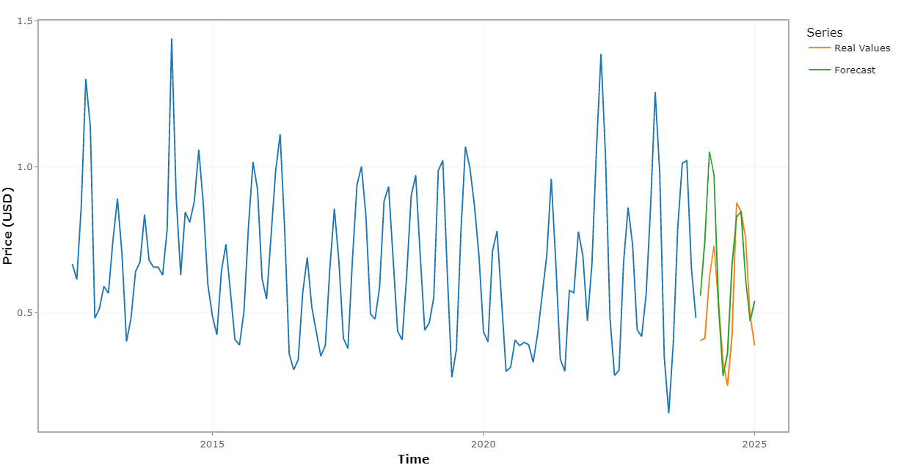
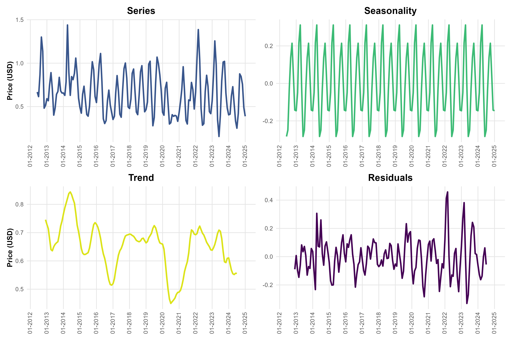

# 🍋 Tahiti Lemon Price Forecasting in Colombia


Time series analysis and forecasting of monthly **Tahiti lemon (*Citrus latifolia*) wholesale prices** in Colombia's three largest markets (**Bogotá**, **Medellín** and **Bucaramanga**) from 2012 to 2025. The goal is to describe the seasonal price cycle and give farmers and traders short-term price forecasts. This work comes from my MBA in Data Science final project (TCC).



## Workflow

1. **Data:** monthly wholesale prices from Colombia's SIPSA price information system (DANE), 2012–2025.
2. **Currency conversion:** COP → USD using exchange rates downloaded with `quantmod`. Gaps are filled with spline interpolation.
3. **Exploration:** series with maximum/minimum points and price-range areas.
4. **Decomposition:** additive and multiplicative decomposition into trend, seasonality and residuals.
5. **Stationarity:** Augmented Dickey-Fuller tests (`tseries`, `urca`) and differencing.
6. **Modeling:** train (2012–2023) / test (2024–2025) split. `auto.arima` is compared with manually specified ARIMA and **SARIMA** models.
7. **Diagnostics:** Ljung-Box test, normality of residuals, ARCH effects.
8. **Evaluation:** test-set RMSE/MAE/MAPE, plus interactive forecast plots (HTML).



## Repository structure

```text
TahitiLemonPriceAnalysis/
├── Data/       # monthly (and daily, Bogotá) price series per market
├── Scripts/    # one script per market (ENG) + Portuguese version + fable test
├── Figures/    # series, decomposition, residuals and forecast plots (PNG/SVG/HTML)
└── Time_Series.Rproj
```

## How to run

```bash
git clone https://github.com/raruizc/TahitiLemonPriceAnalysis.git
```

Open `Time_Series.Rproj` in RStudio and run the scripts in `Scripts/` (`01_Serie_Bogota_ENG.R`, `02_Serie_Bucaramanga_ENG.R`, `03_Serie_Medellin_ENG.R`). Each script installs any missing packages (`forecast`, `tseries`, `urca`, `fpp3`, `quantmod`, `tidyverse`, `plotly`, among others).

## Author

**Ricardo Antonio Ruiz-Cardozo**: PhD candidate in Statistics and Agricultural Experimentation, ESALQ/USP.

Code released under the [MIT License](LICENSE). Price data are public data from SIPSA/DANE (Colombia).
